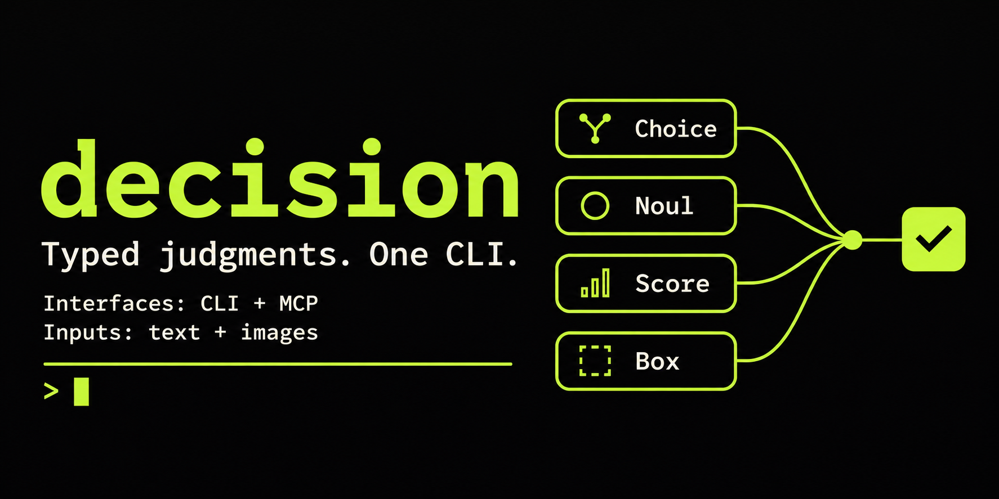

# decision

[](https://github.com/rolandkakonyi/decision/actions/workflows/ci.yml)

One command for typed judgments from Jev, OpenAI/Gemini Decisions, Cloudflare Clef, or compatible providers.
The same executable supports terminal commands, a STDIO MCP server, and
generation of its own companion Agent Skill or a Codex plugin with CLI/MCP integration.

```bash
git clone https://github.com/rolandkakonyi/decision.git
cd decision
uv sync --locked
uv run --locked decision run examples/request.json --dry-run
uv run --locked decision mcp
uv run --locked decision skill --output skills/decision
```

Requires Python 3.11+ and [uv](https://docs.astral.sh/uv/getting-started/installation/).
Install on PATH from a [release tag](https://github.com/rolandkakonyi/decision/releases):

```bash
uv tool install 'git+https://github.com/rolandkakonyi/decision.git@v0.9.0'
```

Release assets also include an installable wheel and source distribution.
To build a standalone executable, use [the build guide](docs/standalone.md).
For a local install, use `uv tool install /path/to/decision`.
The Python distribution is named `decision-harness`; the installed command is
`decision`. Uninstall it with `uv tool uninstall decision-harness`.
For development, `uv tool install --editable .` from the checkout keeps source
edits live. After pulling changes, reinstall a non-editable local install
with `uv tool install --force .`.

## Ask several questions together

```bash
decision run request.json
decision run request.json --json
decision ask --state-file state.json --questions-file questions.json
decision noul 'Does this request a refund?' --state 'Please refund my order.'
```

A request has one `state` and a `questions` object keyed by question IDs.
Each question specifies `type` (`noul`, `choice`, `score`, or `box`),
`instructions`, and any `criteria`. Mixed questions sharing state are sent in
one provider request, and answers retain their IDs. See
[examples/request.json](examples/request.json). `--dry-run` validates without
inference. Human-readable output is the default, including when piped. Add
`--json` before or after a query command to force JSON for scripts. The default
changed in 0.4.0, so existing JSON consumers must add that flag. MCP responses
stay structured. Diagnostics go to stderr; requests are not automatically retried.

## Response stats

Every successful query includes input/output token counts and elapsed request
time, for single questions and mixed batches. Human-readable output ends with:

```text
Usage: 120 input tokens, 12 output tokens
Duration: 243.180 ms
```

JSON output and MCP `structuredContent` include these fields alongside the
model and answers:

```json
{
  "usage": {"input_tokens": 120, "output_tokens": 12},
  "duration_ms": 243.18
}
```

Stats cover the whole batch. `duration_ms` is measured with a monotonic clock
around SDK setup, image upload, and provider response handling. Process startup
and local file validation are excluded. Token counts come from the provider;
unreported counts are `null` in JSON/MCP and shown as unavailable in readable
output. Zero counts remain zero. Dry runs preview a request without inference
and have no response stats.

## Images and Box

```bash
decision choice 'Which breed is the dog in images.dog?' \
  --image dog=dog.jpg \
  --option french_bulldog='French bulldog' \
  --option english_bulldog='English bulldog' \
  --model jev-1.14.0

decision noul 'Is the dog in images.dog a French bulldog?' \
  --image dog=dog.jpg --model jev-1.14.0

decision score 'How clearly is the face of the dog in images.dog visible?' \
  --image dog=dog.jpg \
  --level 'The face is not visible' \
  --level 'The face is partly visible or obscured' \
  --level 'The entire face is clearly visible' \
  --model jev-1.14.0

decision box 'Locate the dog in images.dog' \
  --image dog=dog.jpg --model jev-1.14.0
```

The key before `=` in each `--option` is returned in the answer; the text after
it describes that option. Add `--json` for machine-readable output. Choice
always selects an offered option; add `--option other='Another breed or no identifiable dog'`
if that outcome is allowed.

See the [worked examples](skills/decision/references/examples.md) for all four
question types, multiple images, previews, `ask`, `run`, and MCP. The generated
[dog request](skills/decision/references/dog-request.json) asks all four question
types over one image; copy it beside your own `dog.jpg` before running it.

`--image [NAME=]PATH` can be repeated. Images are added under `state.images`,
keeping existing JSON object fields. Scalar state is retained as `state.context`;
no text state is required when images are supplied. Unnamed files receive the
names `image`, `image_2`, etc. Duplicate names fail explicitly.

Batch JSON also accepts an `assets` map. Use unique references in state,
question instructions, or criteria:

```json
{
  "model": "jev-1.14.0",
  "state": {"photo": "<photo>"},
  "assets": {"<photo>": {"path": "photo.png"}},
  "questions": {
    "present": {"type": "noul", "instructions": "Is there a package in photo?"},
    "location": {"type": "box", "instructions": "Locate the package in photo"}
  }
}
```

Paths in request JSON files are relative to that file; flag paths and paths in
stdin are relative to the working directory. Every asset must be referenced.
Images are sent once per batch: TypeSafe uses multipart uploads; OpenAI and
Cloudflare use base64 data URLs; Gemini uses inline base64 content blocks.

For MCP, replace path descriptors with `{"data_base64": "...", "format": "png"}`.
MCP accepts base64 bytes only, never paths on the server's filesystem. Format is
optional and inferred; png, jpg, and jpeg are accepted. Base64 uses the standard
alphabet without whitespace or a data: prefix.

In TypeSafe mode, the CLI automatically sends `TypeSafe-Danger-Zone-Images: true`
for image or Box requests. TypeSafe currently marks these features experimental; Box requires
Jev 1.14. The CLI checks PNG/JPEG signatures and 16 MiB per file / 32 MiB combined.
The provider validates decoding, dimensions (currently 280-1568 pixels per side),
and expanded-request limits. Images are not resized. See the
[official image docs](https://docs.typesafe.ai/images) and
[examples/images.json](examples/images.json).

## Mix Noul, Box, and Choice in one request

Every named question can have a different type. Save the following as
`dog-mixed-questions.json`:

```json
{
  "dog_present": {
    "type": "noul",
    "instructions": "Is a dog visible in images.dog?"
  },
  "dog_location": {
    "type": "box",
    "instructions": "Locate the dog in images.dog"
  },
  "breed": {
    "type": "choice",
    "instructions": "Which breed is the dog in images.dog?",
    "criteria": {
      "french_bulldog": "French bulldog",
      "english_bulldog": "English bulldog"
    }
  }
}
```

With the CLI, supply the questions and image separately:

```bash
decision ask --questions-file dog-mixed-questions.json \
  --image dog=dog.jpg --model jev-1.14.0
```

Or copy [dog-mixed-request.json](skills/decision/references/dog-mixed-request.json)
beside your `dog.jpg` and use the complete request file:

```bash
decision run dog-mixed-request.json --json
```

Both send **one provider request**, upload the image once, and retain the answer
IDs `dog_present`, `dog_location`, and `breed`. CLI output is human-readable by
default; add `--json` to either command for structured answers. Add `--dry-run`
to preview without inference. Image paths inside request JSON are relative to
that JSON file; `--image` paths are relative to your working directory.

For MCP, call `evaluate` once with this input. Replace the placeholder with
standard base64 of your PNG/JPEG bytes, without whitespace or a `data:` prefix:

```json
{
  "model": "jev-1.14.0",
  "state": {"images": {"dog": "<dog-photo>"}},
  "assets": {
    "<dog-photo>": {"data_base64": "REPLACE_WITH_BASE64_IMAGE_BYTES"}
  },
  "questions": {
    "dog_present": {
      "type": "noul",
      "instructions": "Is a dog visible in images.dog?"
    },
    "dog_location": {
      "type": "box",
      "instructions": "Locate the dog in images.dog"
    },
    "breed": {
      "type": "choice",
      "instructions": "Which breed is the dog in images.dog?",
      "criteria": {
        "french_bulldog": "French bulldog",
        "english_bulldog": "English bulldog"
      }
    }
  }
}
```

MCP returns `structuredContent.answers` keyed by the same three IDs and accepts
base64 assets only. All questions are independent; use `dog_present` to decide
whether to use the location and breed answers after receiving the batch. Box
returns a location even when the dog is absent, and Choice selects an offered
breed. Add an `other` criterion when another breed or no dog is a valid outcome.

## Provider settings

Set `TYPESAFE_API_KEY` or `TYPESAFEAI_API_KEY` for the default TypeSafe host.
Choose the wire API with `--provider typesafe` (the default),
`--provider openai`, `--provider cloudflare`, or `--provider gemini`, or set `DECISION_PROVIDER`. All providers use the same
question files and normalized answer format.

Answers are validated against the request before any batch is returned.
Choice and Score probability maps must contain all offered options and sum to
1 within 0.02, allowing aggregate rounding error. Invalid answers fail the whole
batch. Provider redirects are not followed.

### OpenAI Decisions

With `OPENAI_API_KEY` exported into the command's environment:

```bash
decision noul 'Does the message request a refund?' --state 'Please refund my order.' \
  --provider openai --model gpt-6-luna

decision choice 'Which breed is the dog in images.dog?' \
  --image dog=dog.jpg --provider openai --model gpt-6-luna \
  --option french_bulldog='French bulldog' --option english_bulldog='English bulldog'
```

Copy [openai-dog-questions.json](skills/decision/references/openai-dog-questions.json)
for a mixed Noul, Choice, and Score batch:

```bash
decision ask --questions-file openai-dog-questions.json \
  --image dog=dog.jpg --provider openai --model gpt-6-luna --json
```

Or copy [openai-dog-request.json](skills/decision/references/openai-dog-request.json)
beside your `dog.jpg`:

```bash
decision run openai-dog-request.json --provider openai --model gpt-6-luna --json
```

The adapter calls `POST /v1/decisions` through the official OpenAI SDK. It maps
Noul to `predicate`, named Choice criteria to `choices`, and ordered Score
criteria to `levels`. Answers retain their question IDs and the usual
`noul`/`choice`/`score` types. Objects and arrays of objects become `input_json`
evidence; other state values become text. Images are sent once as shared
base64 data URLs, paired with their reference names. Structured criterion
descriptions are serialized as JSON text; Noul true/false criteria are included
in its instructions.

OpenAI currently supports `gpt-6-luna`, 1–400 questions, 2–255 choices, and
2–10 score levels. **Box is unsupported**: a batch containing Box fails before
any provider call. Refusals, duplicate/missing IDs, or invalid answers fail the
whole batch without returning partial judgments. No automatic retries or
provider fallback are used. See the [official guide](https://developers.openai.com/api/docs/guides/decisions)
and [API reference](https://developers.openai.com/api/reference/resources/decisions/methods/create).

The OpenAI base URL defaults to `https://api.openai.com/v1`, overridable via
`--base-url`, `DECISION_BASE_URL`, or `OPENAI_BASE_URL`, in that order. The default
model is `gpt-6-luna` when no model is selected. `.env.local` is not loaded
automatically; from a checkout, `uv run --env-file .env.local decision ...`
loads the file explicitly without putting the key in command arguments.

### Gemini Decisions

Export `GEMINI_API_KEY` into the command's environment, then select Gemini:

```bash
decision noul 'Does this request a refund?' --state 'Please refund my order.' \
  --provider gemini
decision choice 'Which breed is the dog in images.dog?' \
  --image dog=dog.jpg --provider gemini \
  --option french_bulldog='French bulldog' --option english_bulldog='English bulldog'
```

Noul, Choice, and Score use the shared question format and normalized answers.
For mixed batches, copy
[gemini-dog-questions.json](skills/decision/references/gemini-dog-questions.json)
and pass it to `decision ask --questions-file gemini-dog-questions.json --image dog=dog.jpg --provider gemini --json`.
Alternatively, copy
[gemini-dog-request.json](skills/decision/references/gemini-dog-request.json)
beside your `dog.jpg` and run `decision run gemini-dog-request.json --provider gemini --json`.

The adapter sends one POST to `/v1beta/decisions` with the default model
`gemini-decision-1`. It serializes JSON state as text, labels each named image,
and sends its bytes once as an inline base64 content block. Common Noul criteria
`true`/`false` become `true_description`/`false_description`. Structured criterion
descriptions become JSON text; absent Choice descriptions become empty strings.
Token counts map from Gemini's `total_input_tokens`/`total_output_tokens` into
the common `usage` fields. A zero output count remains zero.

Local checks enforce up to 1000 questions; IDs of 1–64 ASCII letters, digits,
underscores, or hyphens; 2–255 Choice options; and 2–255 nonempty Score levels.
Option IDs allow 1–128 characters with internal ASCII spaces, without edge
spaces, control characters, or non-ASCII spaces. The harness accepts PNG/JPEG
images up to 16 MiB each and 32 MiB combined; Gemini enforces its context and
media limits. Box is rejected before network access. Audio, video, and PDFs
are not accepted by the harness. Invalid, incomplete, or safety-blocked responses
fail the entire batch without partial judgments, redirects, or retries. See the
[official Decisions guide](https://aistudio.google.com/docs/decisions-api).

The base URL defaults to `https://generativelanguage.googleapis.com/v1beta`,
overridable via `--base-url`, `DECISION_BASE_URL`, or `GEMINI_BASE_URL`, in that
order; the adapter appends `/decisions`. `--model` and `DECISION_MODEL` override
the default model. At the official HTTPS host, `GEMINI_API_KEY` takes precedence
over `GOOGLE_API_KEY`; `DECISION_API_KEY` takes precedence over both. An explicit
`--api-key-env` / `DECISION_API_KEY_ENV` selects only that variable. Custom hosts
require a selected credential variable or `DECISION_API_KEY`.

### Cloudflare Clef

Use a Cloudflare Workers AI API token and your account's
32-character ID. Export `CLOUDFLARE_API_TOKEN` (or `CLOUDFLARE_AUTH_TOKEN`) and
`CLOUDFLARE_ACCOUNT_ID`, then run:

```bash
decision choice 'Which breed is the dog in images.dog?' \
  --image dog=dog.jpg --provider cloudflare --model clef-flash \
  --option french_bulldog='French bulldog' --option english_bulldog='English bulldog'
```

`clef` is the default; `clef-flash`, `@cf/cloudflare/clef`, and
`@cf/cloudflare/clef-flash` are also accepted. Noul, Choice, and Score share the
same request format and response stats as the other providers. For a mixed
batch, copy [cloudflare-dog-questions.json](skills/decision/references/cloudflare-dog-questions.json):

```bash
decision ask --questions-file cloudflare-dog-questions.json \
  --image dog=dog.jpg --provider cloudflare --model clef-flash --json
```

Or copy [cloudflare-dog-request.json](skills/decision/references/cloudflare-dog-request.json)
beside `dog.jpg` and run `decision run cloudflare-dog-request.json --provider cloudflare --json`.
Both send one request with one image for all three questions.

The adapter calls `/client/v4/accounts/ACCOUNT_ID/ai/run/@cf/cloudflare/MODEL`
and validates the Workers AI response envelope before returning answers.
Limits: 1–64 questions; IDs of 1–100 letters, digits, underscores, dots, or
hyphens; 2–255 choices; 2–10 score levels. **Box is unsupported** and fails
before sending a request. Up to 4 PNG/JPEG images are allowed, 4 MiB each and
8 MiB combined; the encoded request body must fit within 13 MiB. Cloudflare
enforces image decoding and the 16-megapixel limit. Images are sent in asset
order, with `state._decision_image_references` mapping reference names to
1-based positions. That field is reserved for image requests; scalar state
is preserved under `context`. See the [official Clef docs](https://developers.cloudflare.com/workers-ai/models/clef/)
and [Clef Flash docs](https://developers.cloudflare.com/workers-ai/models/clef-flash/).

`--account-id` overrides `DECISION_ACCOUNT_ID`, then `CLOUDFLARE_ACCOUNT_ID`.
The base URL defaults to `https://api.cloudflare.com/client/v4`, overridable
via `--base-url`, `DECISION_BASE_URL`, or `CLOUDFLARE_BASE_URL`. At the default
root, the adapter adds the account's `/accounts/ACCOUNT_ID/ai/run` path.
A custom base URL must be a **Workers AI run root**, such as an account's
`.../ai/run` or an AI Gateway's `.../workers-ai`; the adapter appends
`/@cf/cloudflare/MODEL`. Custom hosts require `--api-key-env KEY_VARIABLE`
(or `DECISION_API_KEY_ENV`) or `DECISION_API_KEY`. Account IDs and credentials
are server configuration in MCP and cannot be overridden by tool callers.
Dry runs require neither an account ID nor credentials. Cloudflare's
[REST setup guide](https://developers.cloudflare.com/workers-ai/get-started/rest-api/)
recommends its Workers AI token template; custom tokens require Workers AI
Read and Edit permissions.

### Other compatible hosts

Select the matching wire API and override routing and credentials:

```bash
export DECISION_PROVIDER=openai
export DECISION_BASE_URL=https://provider.example/api
export DECISION_API_KEY_ENV=OTHER_PROVIDER_KEY
export DECISION_MODEL=provider-model
decision run request.json
```

`--provider`, `--base-url`, `--api-key-env`, and `--model` override those settings. The key
selector is the name of an environment variable holding the credential, never
the credential itself. `DECISION_API_KEY` can hold an explicitly selected key
directly. Default provider keys are used only on the matching provider's official
HTTPS host. Other hosts require an explicit key selector or `DECISION_API_KEY`.
For `typesafe`, the base URL also honors `TYPESAFE_BASE_URL` and the SDK uses its
usual default model. Compatible hosts must implement the selected Decisions
or System One API; a chat-completions endpoint alone does not suffice.

### Provider extensions

Python installations can load independently packaged providers through the
`decision.providers.v1` entry-point group. Install the extension into the same
environment as `decision`, then select its registered name:

```bash
uv tool install 'git+https://github.com/rolandkakonyi/decision.git@v0.9.0' --with /path/to/provider-package
decision noul 'Is this a greeting?' --state 'Hello' --provider acme
# DECISION_PROVIDER=acme selects it by default for CLI and MCP.
```

Only the selected provider is imported. Built-in names are reserved; duplicate
external registrations fail instead of silently selecting one. Extensions are
trusted Python code with access to the process environment. Install packages
you trust. Standalone executables support the four built-ins; extensions require
a Python installation.

The same model/base-URL/key-selector overrides and common validation apply to
extensions. Provider routing and credential selection remain fixed MCP server
settings. Skill and Codex plugin exports remain deterministic and do not load
external providers; forward extension-specific variable names with
`decision plugin --env-var NAME` when using MCP integration.

See [the provider API](docs/provider-plugins.md) for registration, interface,
validation, and transport requirements. This extension mechanism is separate
from the generated Codex plugin below.

Use repeatable `--disable-provider NAME` flags to exclude installed or built-in
providers for one invocation:

```bash
decision run request.json --provider acme --disable-provider other --disable-provider openai
```

Selecting a disabled provider, including through `DECISION_PROVIDER`, exits with
an input error before loading it or sending a request. There is no fallback or
persistent installation change. For MCP, exclusions are startup flags on
`decision mcp`; tool arguments cannot change them.

## MCP in the same command

```bash
codex mcp add decision -- /absolute/path/to/decision mcp
codex mcp add decision-openai -- /absolute/path/to/decision mcp --provider openai
codex mcp add decision-cloudflare -- /absolute/path/to/decision mcp --provider cloudflare
codex mcp add decision-gemini -- /absolute/path/to/decision mcp --provider gemini
```

The `evaluate` tool accepts `{state, questions, model?, assets?}` and returns structured
answers, model, usage, and `duration_ms` with an output schema. Forward the selected credential
variable and its selector in Codex's MCP environment settings. Provider routing,
account ID, key selection, and timeout are fixed server configuration; tool callers can
override only the model. Stdout is reserved for protocol messages in MCP mode.
OpenAI, Cloudflare, and Gemini servers advertise only Noul, Choice, and Score and their provider limits.
Forward `OPENAI_API_KEY` for the official OpenAI host, or the selected credential
variable and `DECISION_API_KEY_ENV` for another host.
For Cloudflare, forward `CLOUDFLARE_API_TOKEN` and `CLOUDFLARE_ACCOUNT_ID`.
For Gemini, forward `GEMINI_API_KEY` (or `GOOGLE_API_KEY`) for the official host.

## Generate a Codex plugin

Choose how Codex invokes decision:

```bash
decision plugin --output "$PWD/.state/decision-cli" --integration cli
decision plugin --output "$PWD/.state/decision-mcp" --integration mcp
```

Both exports include the generated skill, examples, and schemas. **CLI** mode
uses the installed `decision` command and declares no MCP server. **MCP** mode
(the default) also declares a STDIO server running `decision mcp` and directs
the skill to its `evaluate` tool. The executable must be installed separately
on each host; a plugin export does not bundle a binary or dependencies.

The output is a local marketplace containing `plugins/decision/`. To install
the MCP export explicitly:

```bash
codex plugin marketplace add "$PWD/.state/decision-mcp"
codex plugin add decision@decision-local
```

Start a new Codex session. Set provider/model/base URL/key-selector variables in
Codex's environment; standard credential and Cloudflare account-ID variable
names are forwarded to the MCP process. Values are never written to the export.
For a custom key or a native binary outside PATH:

```bash
decision plugin --output "$PWD/.state/decision-mcp" --integration mcp \
  --mcp-command /absolute/path/to/decision --env-var MY_PROVIDER_KEY
```

Set `DECISION_API_KEY_ENV=MY_PROVIDER_KEY` and `MY_PROVIDER_KEY` in Codex's
environment. `--env-var` is repeatable and applies only to MCP. The generator
ignores current environment values and does not load `.env` files, contact a
provider, register the marketplace, or change Codex settings.

Repeat the original export options with `--check` to verify freshness. Switching
the same output from MCP to CLI removes the old MCP declaration. Regenerate,
run `codex plugin marketplace upgrade decision-local`, then
`codex plugin add decision@decision-local` to refresh, and start a new session.
Both modes use the ID `decision@decision-local`; select one output per host.
The package version changes when generated content or launch settings change.
Exports refuse unmanaged files and symlinks. See the generated
[plugin guide](skills/decision/references/plugin.md) for the complete workflow.

## Generated skill

```bash
decision skill                         # Markdown to stdout, no API call
decision skill --output skills/decision
decision skill --output skills/decision --check
```

The generator owns `skills/decision/SKILL.md` and its example, input schema,
and command reference. The schema and command reference come from the running
tool. Edit `src/decision_cli/skill.py` and the CLI definitions, then regenerate.
CI rejects a stale generated export. No key or provider access is required.

Installing the skill does not install the executable. The export is portable:
copy it into a compatible agent's skill directory, and install `decision` on
that host separately.

## Development

```bash
uv sync --locked --group build
uv run --locked decision skill --output skills/decision --check
uv run --locked python -m unittest discover -s tests -v
uv run --locked python scripts/verify_wheel.py
uv run --locked --group build python scripts/build_standalone.py --output .state/dist
DECISION_TEST_EXECUTABLE="$PWD/.state/dist/decision" \
  uv run --locked python -m unittest discover -s tests -p 'test_*mcp.py' -v
```

Tests use local fixtures without inference. Do not commit environment files,
credentials, build directories, or generated executables. The clean-wheel check
installs outside the checkout and tests CLI, skill generation, images, and MCP.
See [AGENTS.md](AGENTS.md) for the module map, contracts, and narrow checks.

CI runs the source suite on Linux with Python 3.11/3.14 and macOS with 3.14,
plus separate wheel, isolated native Codex plugin, and Linux/macOS standalone jobs. uv/Python and
PyInstaller library caches reduce repeated downloads and processing; build
outputs are always regenerated. Other platforms require native builds and
testing. Dependencies are recorded in `uv.lock`.

See [CONTRIBUTING.md](CONTRIBUTING.md) for contribution and release workflows,
and [SECURITY.md](SECURITY.md) for private vulnerability reporting.

## License

Decision is licensed under the [MIT license](LICENSE). Provider accounts and
inference usage are subject to each provider's separate terms and pricing.
