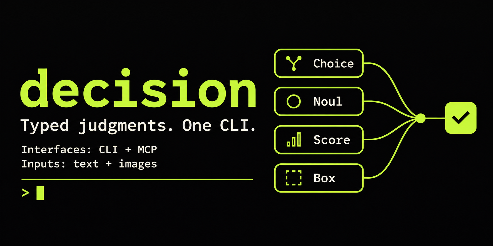

# Decision

[](https://github.com/rolandkakonyi/decision/actions/workflows/ci.yml)
[](https://github.com/rolandkakonyi/decision/releases/latest)

Ask typed questions about text, JSON, and images from your terminal or AI agent.
Decision connects to TypeSafe Jev, OpenAI Decisions, Gemini Decisions, and
Cloudflare Clef through one request format and a common answer format.
Route support messages, score urgency, or locate objects using constrained
answers that scripts can validate.

- **Noul (yes/no probability):** estimate the probability that a statement is true.
- **Choice:** select from named options, with probabilities for each.
- **Score:** rate evidence against ordered levels.
- **Box:** locate a region in an image (TypeSafe only).

Batch questions over shared evidence in one provider request. Use readable CLI
output, JSON for scripts, or the embedded STDIO MCP server. Extend the available
providers with executable plugins written in any language.

## Install

```bash
brew install rolandkakonyi/tap/decision
```

Upgrade with `brew upgrade rolandkakonyi/tap/decision`.

Downloadable archives for macOS ARM64, Linux x86_64, and Windows x86_64 are
available from [GitHub releases](https://github.com/rolandkakonyi/decision/releases/latest).
Verify the SHA-256 checksum, extract the archive, and put `decision`
(`decision.exe` on Windows) on PATH. Keep the accompanying license notices.
macOS and Windows archives are unsigned. Linux archives require a compatible
glibc-based distribution. See the [build guide](docs/standalone.md) for platform
requirements; Homebrew is the simplest installation path on macOS.

To install from a source checkout with Rust:

```bash
cargo install --locked --path .
```

## First query

Validate a request without credentials or inference:

```bash
decision noul 'Does this request a refund?' --state 'Please refund my order.' --dry-run
```

TypeSafe is the default provider. For this walkthrough, export `OPENAI_API_KEY`
into your environment and select OpenAI for the current shell:

```bash
# Requires OPENAI_API_KEY in the environment.
export DECISION_PROVIDER=openai
decision noul 'Does this request a refund?' --state 'Please refund my order.'
```

No model flag is required: each built-in provider has a default model.
[Provider configuration](#provider-configuration) lists credentials and defaults.
Decision does not load `.env` files automatically. Inference is billed by the
selected provider.
`--provider NAME` overrides the shell setting for a single command.

Human-readable output is the default, including when piped. Add `--json` before
or after a query command for structured output. Diagnostics go to stderr.
Use `decision --help` or `decision COMMAND --help` for available options.

## Questions and batches

Ask a single question with its matching command:

```bash
decision choice 'Which team should handle this message?' \
  --state 'I was charged twice.' \
  --option billing='Payments and refunds' \
  --option technical='Bugs and integrations'

decision score 'How urgent is this issue?' \
  --state 'The service is unavailable for all customers.' \
  --level 'Can wait' --level 'Needs attention soon' --level 'Needs immediate attention'
```

Choice returns one of the offered option keys. Include an `other` option when
none of the named options may apply. Score levels run from lowest to highest,
with a numeric score from 0 to the number of levels minus one. Scores may be
fractional; `legend` maps zero-based level keys to their descriptions.

For several questions about the same evidence, save a request as `request.json`:

```json
{
  "state": {"message": "I was charged twice. Please refund the extra payment."},
  "questions": {
    "refund": {
      "type": "noul",
      "instructions": "Does the customer request a refund?"
    },
    "team": {
      "type": "choice",
      "instructions": "Which team handles this message?",
      "criteria": {
        "billing": "Payments and refunds",
        "technical": "Bugs and integrations"
      }
    },
    "blocking": {
      "type": "score",
      "instructions": "How much does the problem block the customer?",
      "criteria": [
        "Can continue normally",
        "Can continue with inconvenience",
        "Cannot continue"
      ]
    }
  }
}
```

```bash
decision run request.json --json
```

Questions share `state` and retain their IDs in the answers. They are evaluated
independently in one provider request; use the returned answers to make any
conditional decisions. Add `--dry-run` to validate and preview the request.
Use `decision run -` to read a request from stdin, or keep evidence and questions
in separate files with `decision ask --state-file state.json --questions-file questions.json`.

Decision validates the entire response before returning a batch. Missing or
invalid answers fail the batch without partial results. Choice and Score
probability maps must include every offered option and total 1 within 0.02.
Requests are not automatically retried, redirected, or sent to a fallback provider.
`--timeout SECONDS` limits query execution (default: 30 seconds); expiration
reports a provider failure without answers.

### Usage and timing

Successful queries include the model, answers, token usage, and elapsed time.
Readable output ends with batch statistics:

```text
Usage: 120 input tokens, 12 output tokens
Duration: 243.180 ms
```

JSON output and MCP `structuredContent` include `usage.input_tokens`,
`usage.output_tokens`, and `duration_ms`. Token counts come from the provider;
unreported counts are `null`, while zero remains zero. Duration is measured by
Decision for the batch, excluding process startup and local file validation.
Dry runs have no response statistics.

## Images

Attach PNG or JPEG images with repeatable `--image [NAME=]PATH` flags:

```bash
decision choice 'Which breed is the dog in images.dog?' \
  --image dog=dog.jpg --provider openai \
  --option french_bulldog='French bulldog' \
  --option english_bulldog='English bulldog' \
  --option other='Another breed or no identifiable dog'

decision box 'Locate the dog in images.dog' \
  --image dog=dog.jpg --provider typesafe
```

Box requires TypeSafe credentials, even when another provider is selected in
your environment.

Images appear under `state.images`. Existing object fields are preserved;
scalar state is retained as `state.context`. Text state is optional when images
are supplied. Unnamed images are named by flag position: `image`, `image_2`, and
so on. For example, `--image dog=dog.jpg --image photo.png` names the second
image `image_2`. Duplicate names are rejected.

Request files can include an `assets` map, with each asset reference used in
state, instructions, or criteria:

```json
{
  "state": {"photo": "<photo>"},
  "assets": {"<photo>": {"path": "photo.png"}},
  "questions": {
    "present": {"type": "noul", "instructions": "Is there a package in photo?"}
  }
}
```

Paths in a request file are relative to that file. Flag paths and paths in stdin
are relative to the working directory. Images are shared across the batch and
are not resized. The common limits are 16 MiB per image and 32 MiB combined;
provider limits may be stricter.

MCP accepts image bytes only, never server filesystem paths. Replace a path
descriptor with `{"data_base64": "...", "format": "png"}`. Use standard base64
without whitespace or a `data:` prefix. Format is optional and inferred from
the bytes; `png`, `jpg`, and `jpeg` are accepted.

TypeSafe image and Box requests use its experimental image API. TypeSafe
validates image decoding and dimensions of 280–1568 pixels per side. A Box answer
can locate a region even when the requested object is absent; pair it with a
Noul presence question when that distinction matters.

See the [worked examples](skills/decision/references/examples.md) for all four
question types, multiple images, and mixed CLI/MCP batches. Ready-to-run request
files are included for [TypeSafe](skills/decision/references/dog-request.json),
[OpenAI](skills/decision/references/openai-dog-request.json),
[Gemini](skills/decision/references/gemini-dog-request.json), and
[Cloudflare](skills/decision/references/cloudflare-dog-request.json).
Copy an image request beside your own `dog.jpg` and select its matching provider:

```bash
decision run openai-dog-request.json --provider openai --json
```

Use `--provider typesafe`, `--provider gemini`, or `--provider cloudflare` for
the corresponding request files. Request files do not select a provider.

## Provider configuration

Choose a provider with `--provider NAME` or `DECISION_PROVIDER`. TypeSafe is the
default. All built-in providers support Noul, Choice, and Score; TypeSafe also
supports Box.

- **[TypeSafe](https://docs.typesafe.ai/images)** (`typesafe`): `TYPESAFE_API_KEY` or `TYPESAFEAI_API_KEY`.
  Default model: `TYPESAFE_DEFAULT_MODEL`, then `jev-latest`.
- **[OpenAI Decisions](https://developers.openai.com/api/docs/guides/decisions)** (`openai`): `OPENAI_API_KEY`.
  Default model: `gpt-6-luna`. Up to 400 questions, 2–255 Choice options,
  and 2–10 Score levels per question.
- **[Gemini Decisions](https://aistudio.google.com/docs/decisions-api)** (`gemini`): `GEMINI_API_KEY` or `GOOGLE_API_KEY`.
  Default model: `gemini-decision-1`. Up to 1000 questions, 2–255 Choice
  options, and 2–255 Score levels per question.
- **[Cloudflare Clef](https://developers.cloudflare.com/workers-ai/models/clef/)** (`cloudflare`): `CLOUDFLARE_API_TOKEN` or
  `CLOUDFLARE_AUTH_TOKEN`, plus `CLOUDFLARE_ACCOUNT_ID`.
  Default model: `clef`; select `clef-flash` with `--model`.
  Up to 64 questions, 2–255 Choice options, and 2–10 Score levels per question.
  Images are limited to four, 4 MiB each and 8 MiB combined, with a 13 MiB
  encoded request limit.

Flags override environment settings. For CLI queries, model selection is
`--model`, then `DECISION_MODEL`, then the request's `model`, then the provider
default. `--account-id` overrides `DECISION_ACCOUNT_ID`, then
`CLOUDFLARE_ACCOUNT_ID` for Cloudflare.

### Compatible endpoints and credentials

Use `--base-url` or `DECISION_BASE_URL` to select another endpoint. Each built-in
provider also accepts its own base URL variable: `TYPESAFE_BASE_URL`,
`OPENAI_BASE_URL`, `GEMINI_BASE_URL`, or `CLOUDFLARE_BASE_URL`, with lower priority.
The endpoint must implement the selected provider's Decisions or System One API;
a chat-completions endpoint alone is insufficient.

```bash
export DECISION_PROVIDER=openai
export DECISION_BASE_URL=https://provider.example/api
export DECISION_API_KEY_ENV=OTHER_PROVIDER_KEY
export DECISION_MODEL=provider-model
decision run request.json
```

`--api-key-env NAME` or `DECISION_API_KEY_ENV` selects the environment variable
holding the credential, not the credential itself. An explicit selector uses
only that variable. Without a selector, `DECISION_API_KEY` takes priority over
provider-specific keys. Provider-specific credentials are used only at the
matching official HTTPS host on port 443; custom hosts require a selector or
`DECISION_API_KEY`.

A custom Cloudflare base URL must be a Workers AI run root, such as an account's
`.../ai/run` or an AI Gateway's `.../workers-ai`. Decision appends
`/@cf/cloudflare/MODEL`.

## Custom providers

Install a package containing `decision-provider.json`, then select its
registered provider name:

```bash
decision providers install /path/to/provider-package
decision providers install 'git+https://github.com/example/acme.git#v1.0.0'
decision providers install https://example.com/acme-1.0.0.tar.gz --sha256 HEX_DIGEST
decision providers list
decision noul 'Is this a greeting?' --state 'Hello' --provider acme
decision providers remove acme
```

Plugins are trusted programs with normal user permissions, written in any
language. Authors own packaging and setup; users supply declared runtimes.
Install from a local directory or manifest, a Git repository with an explicit
revision, or an HTTPS archive with a SHA-256 checksum. Setup runs only during
explicit installation or update, never during evaluation. Git sources require
Git on PATH. Plugin dry runs still start the program for `describe` and
`prepare`, but never call `evaluate`.

Personal registrations load by default. Team registrations require explicit
`--project-config FILE`; the working directory does not activate plugins.
Use repeatable `--disable-provider NAME` flags to exclude installed or built-in
providers for one invocation. Selecting a disabled provider fails before launch.

See the [provider protocol](docs/provider-plugins.md) for package manifests,
installation sources, configuration, and message formats. These provider
programs are separate from the Codex integration below.

## MCP integration

Register the executable with an MCP client, for example Codex:

```bash
codex mcp add decision -- decision mcp --provider openai
```

Ensure the selected credential variables are available to the server through
your client's environment configuration. Use an absolute executable path if
`decision` is not on the client's PATH.

The `evaluate` tool accepts `{state, questions, model?, assets?}` and returns
structured answers, model, usage, and `duration_ms`. Each server uses one
configured provider and advertises its supported question types and limits.
Provider routing, account ID, credential selection, and timeout are fixed at
startup; callers can override only the model. Installed provider artifacts
remain pinned until the server restarts. Stdout is reserved for MCP messages.

For explicit plugin administration, start `decision mcp --management`. This mode
exposes only provider installation, listing, and removal tools.

## Agent skills and Codex plugins

Export a portable Agent Skill with command references, schemas, and examples:

```bash
decision skill --output skills/decision
```

Copy the exported directory into your agent's skill directory. Install the
`decision` executable separately on each host.

For Codex, generate a local plugin marketplace with either CLI or MCP integration:

```bash
decision plugin --output "$PWD/decision-plugin" --integration mcp
codex plugin marketplace add "$PWD/decision-plugin"
codex plugin add decision@decision-local
```

MCP mode includes the skill and declares a server running `decision mcp`.
Use `--integration cli` for a skill that calls the installed command without an
MCP server. Both modes use `decision@decision-local`; choose one per host.
Start a new Codex session after installation.

Exports require no credentials or provider access. They forward standard
environment variable names to MCP without storing their values. Configure
provider, model, and credentials in Codex's environment. For a custom credential
variable or executable location:

```bash
decision plugin --output "$PWD/decision-plugin" --integration mcp \
  --mcp-command /absolute/path/to/decision --env-var MY_PROVIDER_KEY
```

Set `DECISION_API_KEY_ENV=MY_PROVIDER_KEY` and `MY_PROVIDER_KEY` in Codex's
environment. `--env-var` is repeatable. See the
[plugin guide](skills/decision/references/plugin.md) for installation, updates,
and export verification.

## Development and contributing

```bash
git clone https://github.com/rolandkakonyi/decision.git
cd decision
cargo build --locked
cargo test --locked
uv sync --locked
target/debug/decision skill --output skills/decision --check
uv run --locked python -m unittest discover -s tests -v
```

Development requires Rust, Python, and uv. Tests use local fixtures without paid
inference. CI exercises native macOS, Linux, and Windows builds, packaged
artifacts, and real Codex plugin installation.

See [CONTRIBUTING.md](CONTRIBUTING.md) for prerequisites, checks, generated-skill
maintenance, and releases; the [build guide](docs/standalone.md) for archive
verification; and [SECURITY.md](SECURITY.md) for private vulnerability reporting.

## License

Decision is licensed under the [MIT license](LICENSE). Provider accounts and
inference usage are subject to each provider's terms and pricing.
